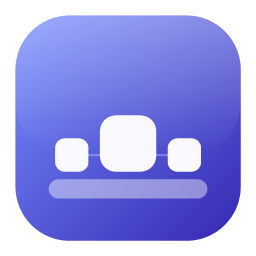
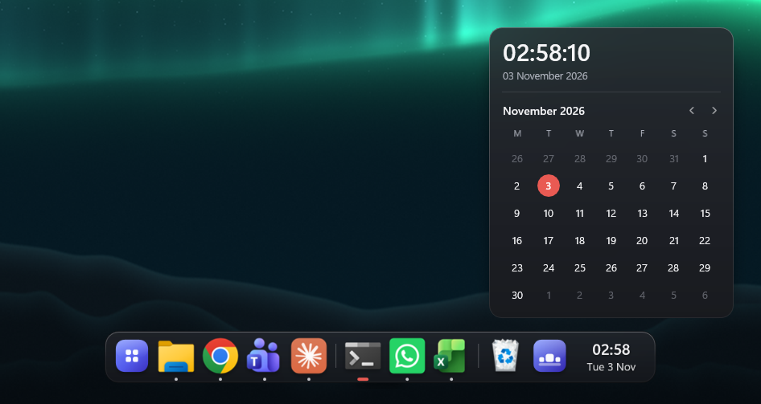
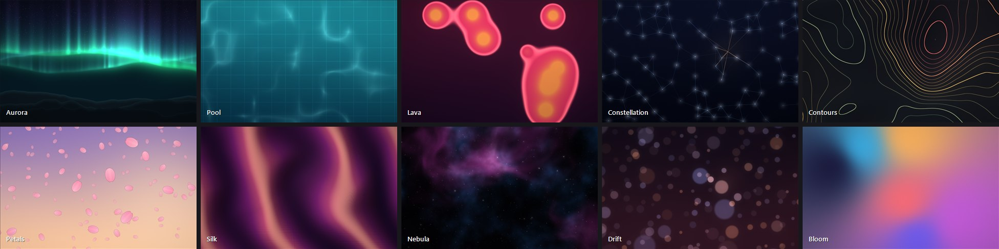

<p align="center">
  
</p>

<h1 align="center">Harbor</h1>

<p align="center">
  A floating dock and live wallpaper for Windows.<br>
  Made by Yusuf Yunus.
</p>

<p align="center">
  <a href="Release/Harbor-Setup-1.1.0.exe"><b>Download the latest version</b></a>
</p>



## Install

1. Open the [Releases page](Release/Harbor-Setup-1.1.0.exe) and download `Harbor-Setup-<version>.exe`.
2. Run it. That one file is everything: it needs no admin rights and carries its own copy of .NET.

The installer isn't code signed, so Windows may show "Windows protected your PC". Choose **More info**, then **Run anyway**.

Harbor installs for the current user only and can be removed from Windows Settings > Apps. Running a newer installer updates it and keeps your settings.

**Needs:** 64-bit Windows 11. Windows 10 version 2004 or later should also work, but hasn't been tested.

## What it does

### The dock

- **Magnification** that follows your pointer smoothly, with real blurred glass behind the icons.
- **A dock on every screen**, with the same apps on each, sized correctly even when your screens are scaled differently. You can limit it to the main screen in Settings.
- **Clock and calendar** at the end of the dock. Hover for the time to the second and a month you can page through.
- **Window previews**: hover a running app to see live pictures of its windows. Click one to switch to it, or use its X to close it.
- **One icon per app**, however Windows labels its windows, and your taskbar pins are imported the first time you run it.
- **Now Playing tile** with album art. Click to play or pause, scroll to skip.
- **Optional extras**: auto-hide when a window covers the dock, and hiding the Windows taskbar. If Harbor is ever killed, the taskbar comes back the next time it starts.

### The quick panel

Hover the Harbor icon for volume, a brightness slider for each screen, battery level and wallpaper motion. External monitors are controlled over DDC/CI, so one that doesn't support it won't get a slider.

<p align="center">
  
</p>

### The live wallpaper

Ten scenes that react to your mouse, drawn at your screen's own resolution behind the desktop icons. You can also use your own video.



- **Interactive**: light and movement follow your pointer, and clicks on the desktop send ripples.
- **React to music** (optional): the bass, mids and treble of whatever your PC is playing drive the scene. Nothing is recorded or stored.
- **Careful with power**: the wallpaper stops when it's hidden behind windows, under a full-screen game, or when the PC is locked. It slows down on battery and goes still when the battery is low. It also asks Windows for the power-saving graphics chip, so it shouldn't wake a gaming GPU on its own.

## Privacy

Harbor has no accounts and no telemetry, and it doesn't connect to the internet. Settings stay on your PC in `%APPDATA%\Harbor`, and logs in `%LOCALAPPDATA%\Harbor`.

## Known limitations

- Developed and tested on one Windows 11 PC so far, so please report anything odd on yours.
- The installer isn't code signed, and there's no automatic update check.
- The dock doesn't reserve screen space, so it covers the bottom of maximized windows unless auto-hide is on.
- Over a very bright page, the dock's soft shadow shows as a faint smudge at its centre rather than along its length.

## Build it yourself

You need the [.NET 9 SDK](https://dotnet.microsoft.com/download/dotnet/9.0) on Windows. Visual Studio isn't required.

```powershell
# Run it
dotnet run --project src\Harbor

# Build the one-file installer, written to dist\Harbor-Setup-<version>.exe
powershell -ExecutionPolicy Bypass -File build\make-installer.ps1
```

The version number and credit live in `src\Directory.Build.props`.

### How it's put together

```
src/Harbor
  Composition/   the compositor and drawing surfaces
  Dock/          the dock, its panels, window tracking, volume, brightness and taskbar control
  Wallpaper/     the render thread, power rules, music analysis and scenes (Scenes/*.hlsl)
  Interop/       Windows API declarations and icon extraction
  UI/            settings window, theme, tray icon, previews and autostart
src/HarborSetup  the installer and uninstaller
build/           the script that builds the installer
```

The dock is drawn with Windows.UI.Composition, so its animations run on the system compositor with no per-frame work in Harbor. The wallpaper renders with Direct3D 11 on its own thread, one swapchain per monitor.

## Credits

Harbor was inspired by [WinDock](https://github.com/ihsanmaulanahamdani/win-dock) by Ihsan Maulana Hamdani. Reading Lively Wallpaper, Seelen UI, LuminWallpaper, ManagedShell, RetroBar, Nectar, aero-dock and OneTaskBar helped with how Windows handles the desktop, windows and the taskbar. All of the code here was written from scratch.

It uses [Vortice.Windows](https://github.com/amerkoleci/Vortice.Windows), [NAudio](https://github.com/naudio/NAudio) and .NET. Their licenses are listed in [THIRD-PARTY-NOTICES.txt](src/Harbor/THIRD-PARTY-NOTICES.txt).

## License

Copyright (c) 2026 Yusuf Yunus. All rights reserved.
